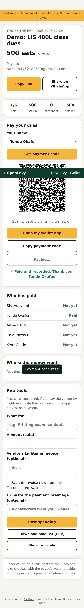

# OpenLevy ⚡

**Class dues on Bitcoin Lightning. Everyone sees who paid, and every spend can be proven.**

Built for the [Dakar Bitcoin Hack 2026](https://dakar-bitcoin-hack-2026.devpost.com/) by BTrust.

Live app: https://yunganas.github.io/openlevy/web/

## Two modes, clearly labelled

| Mode | What happens | Label |
| --- | --- | --- |
| **Demo** | Instant click-through. Free NWC Faucet test wallets make simulated payments. No funds move. | `DEMO` badge and banner |
| **Testnet** | Real Lightning invoices on **Bitcoin signet**, paid from a signet wallet (for example Blink switched to its test server), verified with the payee's provider (LUD-21) and the preimage. Test coins have no value. | `TESTNET` badge and banner |

The mode is written into the levy link, so demo and testnet ledgers can never mix. A testnet levy only accepts signet/testnet invoices, and a demo levy rejects them (tested). Mainnet support exists in the code but is not used for judging.



## The problem

In Nigerian universities, class reps collect departmental dues, excursion fees and project levies. Today that means bank transfers to a personal account, "I've paid, check your alert" screenshots on WhatsApp, a hand-kept list, and no record of where the money went. Students argue about who paid; reps get accused even when honest.

## What OpenLevy does

1. **The rep creates a levy**: what it's for, amount in sats (with a naira estimate), due date, their Lightning address, and the class list (names only).
2. **One link** goes on the class WhatsApp group. No sign-up, no app install.
3. **Each student picks their name and pays** straight to the rep's wallet: scan the QR, open any Lightning wallet, or pay in one tap with a connected NWC wallet.
4. **The payment is checked, not trusted.** OpenLevy asks the payee's own Lightning provider whether the invoice is settled (LUD-21 `verify`) and checks that the returned preimage hashes to the invoice's payment hash. Only then does it post a receipt to Nostr.
5. **Anyone with the link sees the board**: who paid, total collected, what was spent, and the balance.
6. **Provable spending.** The rep posts each expense, signed with a rep key only they hold. If the vendor was paid by Lightning, the rep attaches the vendor's invoice and the preimage, and the entry is marked **⚡ Proven**. Cash spends show as **Claimed, no proof**, so the class can tell the difference.
7. Anyone can **question an expense**. The flag shows on it for the whole class.
8. The ledger shows expected vs collected, who still owes, filters and search, a short payment reference and time for each payment, and an activity feed.
9. Each invoice shows its expiry, with clear states: waiting, verifying, paid, expired, failed. Nothing is marked paid until it's verified.
10. The rep can download the paid list as CSV (formula-safe).

## How it's built

- Static web app (one HTML file + one 84 KB gzipped JS bundle), so it loads on mid-range phones and cheap data. Hosted on GitHub Pages. No server, no database, no accounts.
- **Lightning**: LUD-16 Lightning addresses for invoices, LUD-21 `verify` for payment status, preimage checks with `@getalby/lightning-tools`.
- **Nostr Wallet Connect** (`@getalby/sdk`) for optional one-tap pay. The connection string stays on the student's own phone.
- **Nostr** (`nostr-tools`, NIP-78 kind 30078 events) as the shared, public receipt book. Relays: damus, nos.lol, primal.
- **Test mode** uses the [NWC Faucet](https://faucet.nwc.dev) (fake sats in isolated test wallets).

```
student phone ──LNURL──▶ rep's Lightning provider (invoice + verify URL)
      │ pays any wallet / NWC
      ├──verify + preimage check──▶ settled? ──▶ signed receipt ──▶ Nostr relays
anyone with link ◀── board built from relays, every receipt re-verified ◀──┘
rep phone ── spend entry signed with rep key (+ vendor invoice & preimage) ──▶ Nostr
```

## Security by design

| Threat | What OpenLevy does |
| --- | --- |
| Fake "I paid" receipt | Receipts are pointers only. Each is re-checked with the payee's provider, the invoice amount must equal the levy amount, and the preimage must hash to the payment hash. |
| Verify URL pointing to an attacker's server | The verify URL must be HTTPS on the same domain as the payee's Lightning address. |
| One payment claimed by two students | Each payment hash counts once. |
| Someone else posting fake spending | Spend entries count only if signed by the rep's public key, which is fixed in the levy link. |
| Wallet secrets leaking | NWC connections and the rep key are stored only in the device's local storage. They are never in the link, never sent to a server. The link holds the levy key (for posting receipts), never a wallet secret. |
| Custody | OpenLevy never holds money. Students pay the rep's wallet directly. |
| Personal data | Names only. The form warns reps not to add phone or matric numbers, because the paid list is public to anyone with the link. |
| XSS from names or notes | All user text is escaped before rendering. |

## Known limitations (honest list)

- Anyone with the link can post a receipt under any name. A real payment still counts only once, but if two people race to claim the same payment, the earliest receipt wins. Fix next: students sign receipts with their own Nostr key.
- Receipts and spending notes are public on Nostr relays. Don't put sensitive info in them.
- The payee's wallet must support LUD-21 `verify` (Alby Lightning addresses do; many others don't yet).
- Paying a vendor in cash can't be proven; it shows as "Claimed".
- Demo payments are simulated by the NWC Faucet. Testnet payments are real signet Lightning payments. It has not been used with real sats or real classes yet.
- The naira estimate uses Alby's rate API and is only indicative.

## Run it

```bash
npm install
npm run build   # bundles src/ into web/app.js
npm test        # end-to-end test on NWC Faucet test wallets + public Nostr relays
npx serve web   # or any static server
```

The end-to-end test (23 checks) creates test wallets, has two students pay by Lightning, posts receipts to Nostr, has the rep post a verified and a reported spend, flags a spend, injects fake receipts, a reused payment, a foreign verify URL, an outsider's spend and a wrong-network (signet) receipt, then checks the board shows exactly the right paid list, totals and flags. It also gets a real signet invoice from Blink's staging server and confirms an unpaid one reads as pending, not paid.

## Why there is no OpenLevy server

Payments are verified by the rep's own wallet provider (LUD-21 `verify`) plus a preimage check done in every viewer's browser. That gives server-side verification without OpenLevy running a server: there is no database to hack, no API key to leak, and OpenLevy never holds money.

## What's next

- Students sign receipts with their own Nostr key
- Yoruba, Hausa, Igbo and Pidgin labels
- Installments and late fees
- Naira on-ramp through a local Lightning exchange

## Credits

Built by Akangbe Anas Alani (FUTA, Akure) with help from an AI assistant for code and docs. MIT licensed.
